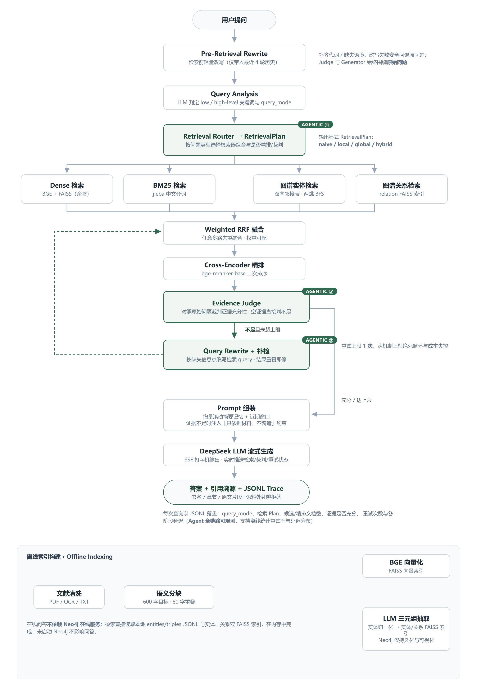

# ChenJiageng-RAG · 嘉庚智答

**Knowledge-Graph Enhanced Agentic RAG — built from scratch, no framework lock-in.**

A question-answering system over the Tan Kah Kee (陈嘉庚) literature corpus (*Nanyang Huiyilu*, collected speeches, etc.) that combines **four-way hybrid retrieval** (dense / BM25 / KG entity / KG relation), **weighted RRF fusion**, **cross-encoder reranking**, and exactly **three LLM decision points** inside a fixed, controllable workflow — producing **citation-grounded, low-hallucination answers** with a full JSONL execution trace.

English | [简体中文](README.zh-CN.md)

[](https://www.python.org/)
[](https://fastapi.io/)
[](https://github.com/alinj4253-droid/ChenJiageng-RAG/actions/workflows/tests.yml)
[](LICENSE)

<p align="center">
  
</p>

## Why workflow-first Agentic RAG?

Multi-agent orchestration is powerful but hard to control and costly to debug. This system takes the opposite bet: **keep the pipeline fixed, and let the LLM decide only where it matters** — three bounded decision points:

| # | Decision point | What the LLM decides | Guardrail |
|---|---|---|---|
| ① | **Retrieval Router** | Classifies the question into `naive / local / global / hybrid` and emits an explicit `RetrievalPlan` | Rule + LLM; disabling it falls back to full hybrid |
| ② | **Evidence Judge** | Whether retrieved evidence suffices to answer the *original* question | Empty evidence → insufficient without an LLM call; judge failure fails-open |
| ③ | **Bounded Rewrite & Retry** | Rewrites the retrieval query toward the missing information points | Retry budget = 1; duplicate rewrites stop immediately |

Everything else — rewrite fallback, RRF fusion weights, reranking, prompt assembly — is deterministic code. Retry budgets and agent switches are all configurable in `src/config.py`.

## Highlights

- **4-way hybrid retrieval**: BGE dense (FAISS) + BM25 (jieba) + KG entity retrieval (bidirectional two-hop BFS with weight decay) + KG relation retrieval (relation FAISS index), combined per the router's plan.
- **Weighted RRF fusion** over any number of active channels, then **bge-reranker-base** cross-encoder reranking.
- **Citation grounding**: every answer carries book title, chapter and quoted passages; out-of-corpus questions get a polite refusal instead of a guess.
- **Full observability**: every query appends a JSONL trace — routing decision, candidate/reranked counts, evidence sufficiency, retry count, per-stage latency (`logs/rag_trace.jsonl`).
- **Incremental rolling-summary memory**: a `summarized_until_message_id` cursor guarantees each old message is summarized exactly once.
- **SSE streaming** with live pipeline status (retrieving / judging / retrying).
- **Knowledge graph pipeline**: LLM triple extraction → entity normalization → dual entity/relation FAISS indexes; Neo4j is used for persistence & visualization only — **online QA does not depend on a running Neo4j**.
- **Fully mocked test suite**: pytest runs with no API key, no model weights, no external services.

## Quick Start

Requirements: Python 3.11+, a DeepSeek API key (or local Ollama). Neo4j is optional.

```bash
# 1. clone & install
git clone https://github.com/alinj4253-droid/ChenJiageng-RAG.git
cd ChenJiageng-RAG
pip install -r requirements.txt

# 2. download local embedding / reranker models into data/models/
huggingface-cli download BAAI/bge-base-zh-v1.5 --local-dir data/models/models/BAAI--bge-base-zh-v1.5/snapshots/master
huggingface-cli download BAAI/bge-reranker-base --local-dir data/models/models/BAAI--bge-reranker-base/snapshots/master

# 3. configure
cp .env.example .env        # then edit: OPENAI_API_BASE / OPENAI_API_KEY (+ Neo4j only for viz)

# 4. build indexes from cleaned UTF-8 TXT files in data/clean/
python -m src.chunker          # semantic chunking (600-char target, 80 overlap)
python -m src.vector_store     # FAISS vector index
python -m src.kg_extractor     # LLM triple extraction (with failure circuit-breaker)
python -m src.kg_normalizer    # entity normalization
python -m src.kg_indexer       # entity/relation FAISS indexes
python -m src.neo4j_importer   # optional: Neo4j for visualization only

# 5. run
python -m uvicorn src.app:app --host 0.0.0.0 --port 8000
```

| Page | URL |
|---|---|
| Chat UI | http://localhost:8000 |
| Graph visualization | http://localhost:8000/graph |
| API docs | http://localhost:8000/docs |

> Raw PDFs must be extracted / OCR'd / cleaned into UTF-8 TXT under `data/clean/` before indexing; the repository does not ship the copyrighted corpus.

## API Overview

| Method | Path | Purpose |
|---|---|---|
| POST | `/api/chat` | Single-turn synchronous RAG query (returns answer, references, latency) |
| POST | `/api/chat/stream` | **Main multi-turn chat (SSE)**: session persistence, rolling summary, streaming tokens and pipeline status |
| GET/POST/DELETE | `/api/sessions…` | Session management |
| GET | `/api/graph?entity=…` | Sub-graph data for visualization |
| GET | `/api/health` | Health check |

## Testing & CI

```bash
pip install -r requirements.txt -r requirements-dev.txt
pytest -q
```

All LLM/FAISS/embedding/network dependencies are mocked. GitHub Actions runs `pytest -q` on every push/PR to `main` (see the tests badge). Integration tests requiring a real environment are marked `@pytest.mark.integration` and skipped in CI.

## Project Structure

```
src/    23 modules: app, rag_pipeline, retrieval_router, evidence_judge,
        query_rewriter, memory_manager, hybrid_retriever, graph_retriever,
        reranker, kg_extractor, kg_normalizer, kg_indexer, trace_logger, ...
tests/  pytest suite (fully mocked)
web/    chat page + knowledge-graph visualization (vis-network)
docs/   architecture diagrams
```

Key configuration switches (defaults in `src/config.py`): `ENABLE_AGENT_ROUTING`, `ENABLE_EVIDENCE_JUDGE`, `MAX_RETRIEVAL_RETRY=1`, `ENABLE_RELATION_RETRIEVAL`, `ENABLE_TRACE_LOG`, RRF weights, memory window.

## License

Non-commercial — see [LICENSE](LICENSE). This project is for study and research only; commercial use is not permitted. Copyright of the Tan Kah Kee literature belongs to its original authors and publishers.

中文介绍与完整配置说明见 [README.zh-CN.md](README.zh-CN.md)。
