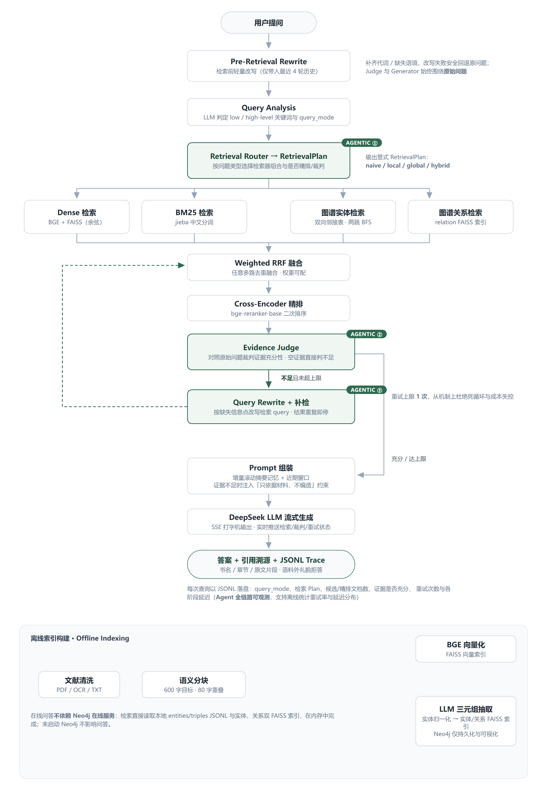

# 嘉庚智答 · ChenJiageng-RAG

> 面向陈嘉庚文献语料库（《南侨回忆录》《陈嘉庚言论集》《新中国观感集》等）的
> **知识图谱增强 Agentic RAG 问答系统**。固定 Workflow 保证整体可控，
> 仅在**检索路由、证据充分性裁判、有限查询改写重试**三个关键节点引入 LLM 决策
> （Workflow-first，不使用 Multi-Agent / LangGraph 编排），
> 输出**带引用、可溯源、低幻觉**的答案，并以 JSONL Trace 记录全链路执行过程。

[English](README.md) | 简体中文

[](https://www.python.org/)
[](https://fastapi.tiangolo.com/)
[](https://github.com/alinj4253-droid/ChenJiageng-RAG/actions/workflows/tests.yml)
[](LICENSE)

<p align="center">
  
</p>

## 核心特性

| 能力 | 实现要点 |
|---|---|
| **三处 Agentic 决策点** | ① Retrieval Router 输出显式 `RetrievalPlan`（naive / local / global / hybrid）；② Evidence Judge 对照**原始问题**裁判证据充分性，空证据直接判不足且不调用 LLM；③ 证据不足时受限改写补检，**上限 1 次**、改写重复即停，从机制上杜绝死循环 |
| **Pre-Retrieval Rewrite** | 检索前轻量改写（补齐代词/语境，仅带最近 4 轮历史）；无 history 仍改写、坏 history 不崩溃、失败安全回退原问题；Judge 与 Generator 始终围绕原始问题，避免改写漂移导致答非所问 |
| **多路混合检索** | BGE 向量（FAISS）+ BM25（jieba 分词）+ 图谱实体检索（双向邻接表两跳 BFS，权重衰减、保留关系方向）+ 图谱关系检索（relation FAISS 索引），按 Plan 动态组合 |
| **Weighted RRF 融合** | 不写死路数，按 Plan 实际启用的检索路做 `weight/(k+rank+1)` 累加融合去重，权重可配；融合后 bge-reranker-base 交叉编码精排 |
| **谨慎生成** | 重试后证据仍不足时注入「只依据材料、不编造、无据明说」约束；语料外问题礼貌拒答 |
| **引用溯源** | 答案附书名、章节与原文片段 |
| **增量滚动摘要记忆** | `summarized_until_message_id` 游标保证每条滑出近期窗口（6 条）的消息只摘要一次 |
| **结构化 Trace** | 每次查询以 JSONL 记录 query_mode、检索 Plan、候选/精排文档数、证据充分性、重试次数与分阶段延迟（`logs/rag_trace.jsonl`），支持离线统计重试率/延迟分布 |
| **SSE 流式输出** | 打字机效果，实时推送「检索 / 裁判 / 改写重试」状态 |
| **全 mock 测试** | pytest 覆盖改写、路由、裁判、重试循环、图谱遍历、摘要、降级等，无需 API Key / 模型 / 外部服务 |

## 系统架构

上图即完整链路：在线问答流水线（三处 Agentic 决策点以绿色高亮）+ 离线索引构建面板。

**离线索引**：原始文献经文本提取/OCR/清洗为 UTF-8 TXT 后，语义分块（600 字目标、80 字重叠），
一路 BGE 向量化入 FAISS；一路 LLM 抽取三元组、实体归一化后建立实体/关系双 FAISS 索引。
Neo4j 5.x 仅用于图谱持久化与 `web/graph.html` 可视化——**在线问答直接读取本地
entities/triples JSONL 与双 FAISS 索引，不依赖 Neo4j 在线服务**。

## 技术栈

| 层次 | 选型 |
|---|---|
| 后端框架 | FastAPI + Uvicorn |
| 向量检索 | FAISS（IndexFlatIP 余弦相似度） |
| 嵌入 / 重排模型 | BAAI/bge-base-zh-v1.5 · BAAI/bge-reranker-base（本地加载，lazy 单例） |
| 关键词检索 | BM25 + jieba 中文分词 |
| 知识图谱 | 三元组 + 实体/关系双 FAISS 索引；Neo4j 5.x（仅持久化与可视化） |
| LLM | DeepSeek-Chat API（OpenAI 兼容接口，支持 Ollama 降级） |
| 会话存储 | SQLite + SQLAlchemy ORM |
| 前端 | 原生 HTML / JavaScript + vis-network + marked.js + DOMPurify |
| 流式传输 | SSE（Server-Sent Events） |
| 测试 | pytest（全部 mock，不依赖真实模型 / API / Key） |

## 快速开始

环境要求：Python 3.11+、DeepSeek API Key（或本地 Ollama）；Neo4j 仅图谱可视化需要。

```bash
# 1. 克隆并安装依赖
git clone https://github.com/alinj4253-droid/ChenJiageng-RAG.git
cd ChenJiageng-RAG
pip install -r requirements.txt

# 2. 下载嵌入/重排模型到 data/models/
huggingface-cli download BAAI/bge-base-zh-v1.5 --local-dir data/models/models/BAAI--bge-base-zh-v1.5/snapshots/master
huggingface-cli download BAAI/bge-reranker-base --local-dir data/models/models/BAAI--bge-reranker-base/snapshots/master

# 3. 配置环境变量
cp .env.example .env   # Windows: copy .env.example .env
# 编辑 .env：OPENAI_API_BASE / OPENAI_API_KEY（Neo4j 仅可视化需要）

# 4. 准备数据并构建索引（清洗后的 UTF-8 TXT 放入 data/clean/）
python -m src.chunker          # 文本分块
python -m src.vector_store     # 向量索引
python -m src.kg_extractor     # 三元组抽取（含连续失败熔断）
python -m src.kg_normalizer    # 实体归一化
python -m src.kg_indexer       # 实体/关系向量索引
python -m src.neo4j_importer   # 可选：导入 Neo4j（仅可视化）

# 5. 启动服务
python -m uvicorn src.app:app --host 0.0.0.0 --port 8000
```

| 页面 | 地址 |
|---|---|
| 聊天问答 | http://localhost:8000 |
| 知识图谱可视化 | http://localhost:8000/graph |
| API 文档 | http://localhost:8000/docs |

> 原始 PDF / OCR 文本需在仓库外完成提取、清洗并放入 `data/clean/`；
> 项目不随仓库分发受版权保护的文献语料。

## 主要 API

| 方法 | 路径 | 说明 |
|---|---|---|
| POST | `/api/chat` | 单轮同步 RAG 查询，返回 answer / references / latency |
| POST | `/api/chat/stream` | **多轮聊天主链路（SSE）**：Session 持久化、近期窗口、增量滚动摘要、流式 token 与状态推送 |
| GET/POST/DELETE | `/api/sessions…` | 会话管理（列表 / 新建 / 历史 / 删除） |
| GET | `/api/graph?entity=…` | 图谱子图数据（可视化用） |
| GET | `/api/health` | 健康检查 |

## 测试与 CI

```bash
pip install -r requirements.txt -r requirements-dev.txt
pytest -q
```

所有测试用 mock 隔离 LLM、FAISS、Embedding 与网络，无需任何真实资源即可运行。
push / PR 到 `main` 时 GitHub Actions 自动运行 `pytest -q`（见顶部 tests badge）。
需要真实环境的集成测试标记 `@pytest.mark.integration`，默认 CI 不运行。
覆盖：检索前改写（无 history / 坏 history / 失败回退）、查询分析、检索路由、证据裁判、
有限重试循环（含死循环防护）、混合检索融合、图谱双向遍历与关系检索、增量滚动摘要、
会话存储、单轮/流式接口职责、trace 落盘、LLM 在线/本地降级等。

## 项目结构

```
ChenJiageng-RAG/
├── src/                        # 23 个后端模块
│   ├── app.py                  # FastAPI 主入口（路由 + SSE 流式）
│   ├── config.py               # 全局配置（路径、模型、超参、Agent 开关）
│   ├── rag_pipeline.py         # 主流水线：路由→检索→裁判→有限重试→生成
│   ├── retrieval_router.py     # 【Agentic ①】RetrievalPlan + 规则选路
│   ├── evidence_judge.py       # 【Agentic ②】证据充分性裁判
│   ├── query_rewriter.py       # 检索前改写 + 【Agentic ③】证据不足补检
│   ├── memory_manager.py       # 增量滚动摘要
│   ├── trace_logger.py         # 结构化执行 Trace（JSONL）
│   ├── hybrid_retriever.py / vector_store.py / bm25_store.py
│   ├── graph_retriever.py / reranker.py / rag_generator.py
│   ├── kg_extractor.py / kg_normalizer.py / kg_indexer.py / neo4j_importer.py
│   └── db.py / prompts.py / llm_client.py / milvus_migrator.py ...
├── tests/                      # pytest（全部 mock）
├── web/                        # 聊天页面 + 图谱可视化
├── docs/images/                # 架构图
└── .env.example                # 环境变量模板
```

> `data/`（模型、分块、索引）、`logs/`、`.env` 等由 `.gitignore` 排除。

## 关键配置（`src/config.py`）

| 配置 | 默认 | 说明 |
|---|---|---|
| `ENABLE_AGENT_ROUTING` | `True` | 关闭后所有问题走全量 hybrid |
| `ENABLE_EVIDENCE_JUDGE` | `True` | 关闭证据裁判即同时关闭重试 |
| `MAX_RETRIEVAL_RETRY` | `1` | 证据不足时最多补检次数 |
| `ENABLE_RELATION_RETRIEVAL` | `True` | global / hybrid 模式是否启用关系向量检索 |
| `ENABLE_TRACE_LOG` | `True` | 是否写 JSONL Trace |
| `RECENT_WINDOW` | `6` | 对话短期记忆窗口（消息条数） |
| `ENTITY_GRAPH_WEIGHT` / `RELATION_GRAPH_WEIGHT` | `0.2` | 两路图谱检索在 Weighted RRF 中的权重 |

## 设计取舍说明

- **为何不用 Multi-Agent 编排**：多 Agent 灵活但行为发散、调试成本高；本系统把 LLM 决策
  收敛到三处有明确护栏的节点（显式 Plan、裁判口径、重试上界），其余步骤全部确定性代码，
  保证行为可复现、成本可预估。
- **改写与问答的隔离**：检索前改写只服务检索端，Judge / Generator 始终针对用户原始问题，
  防止「改写漂移」导致答非所问。
- **RetrievalPlan 显式化**：路由输出 frozen Plan，检索、融合、裁判只依赖 Plan，
  新增检索路无需改业务代码。

## License

本项目仅供学习与交流使用，禁止商用，详见 [LICENSE](LICENSE)。
陈嘉庚文献语料版权归原作者与出版社所有。
